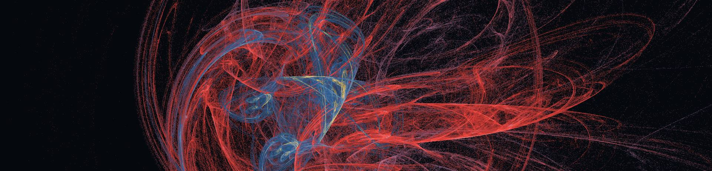
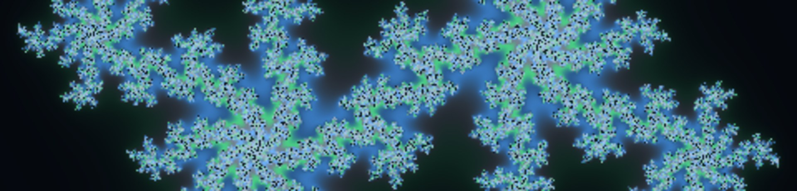
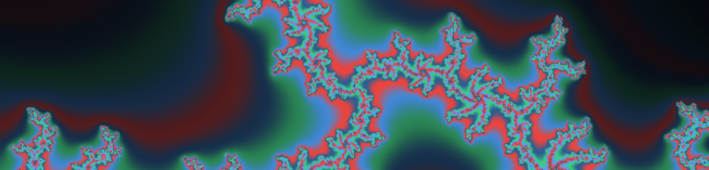
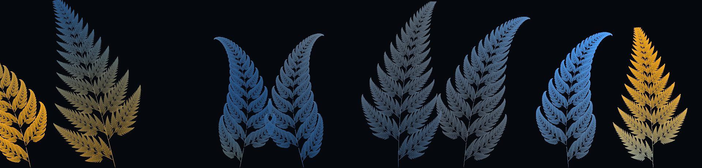
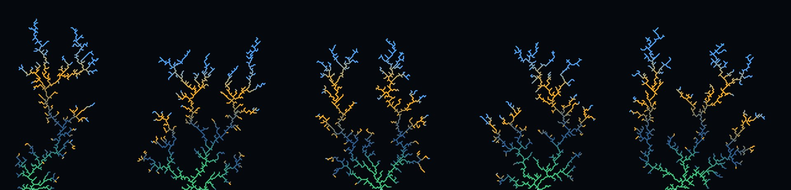

# kiosko-plugin-fractals

Generative fractals as interludes, in your theme's colours: a **fractal
flame** that develops on the panel like a photo in the developer, from faint
dust to glowing filaments; a **Julia set** that twists and turns as its
parameter walks around the Mandelbrot set; a **dive into the Mandelbrot
set**; a **meadow of Barnsley ferns** growing along the bar; and **coral**
branching up from the bottom (or frost hanging from the top). Each time slot
paints a different piece; the same slot always paints the same one.

A plugin for [Kiosko](https://github.com/kiosko-lcd/kiosko), the widget mosaic
for small USB LCD panels. **Optional:** Kiosko doesn't install it.



The pictures in `docs/` (a still and a few seconds of video of each
interlude, for the plugin store) were painted by this plugin itself, in the
default theme.

## Install

```sh
npm install --prefix ~/.config/kiosko/plugins kiosko-plugin-fractals
```

(macOS: `~/Library/Application Support/Kiosko/plugins`, Windows: `%APPDATA%\Kiosko\plugins`.)

Then add an interlude to a screen: **Screens → Interludes → Fractal flame**
(or **Morphing Julia**, **Mandelbrot dive**, **Fern meadow**, **Growing
coral**). Like any interlude it plays at its time slot (every
15 min = at :00, :15, :30, :45) for up to `maxSeconds`, or right away from the
editor or Home Assistant. 30 s suits both.

## What it does on your machine

Nothing beyond computing: no network, no files, no programs. Pure
TypeScript, drawn on the canvas Kiosko provides.

It takes a share of the processor while it plays (`cpu`, 40 % of each frame
by default), and less by itself when frames come late. Getting ready takes
about a third of a second for the flame (choosing a composition that fills
the bar), a few milliseconds for the others. Memory: two histograms of the
panel's size for the flame and the ferns (about 7 MB at 1920×462), a canvas
of the panel's size for the coral, a few smaller buffers for the rest.

Times (`revealMs`, `growMs`, `zoomMs`, `loopMs`) are by the clock: a screen
that plays slower than 15 frames a second still takes the time asked.

## What it does

**The flame** is Scott Draves' algorithm, the one behind Apophysis and
Electric Sheep: the chaos game over two to four random affine maps, each bent
by a blend of nonlinear variations (sinusoidal, spherical, swirl, horseshoe,
polar, julia, spiral, disc…), sometimes with a mirror or a rotation for
symmetry. Of a couple of dozen candidates it keeps the one that best fills a
wide bar, and turns it so its long axis lies along the panel. The points are
gathered in a density histogram and shown with log-density and gamma, so
they come up like a print in the tray; the densest cores burn towards the
theme's ink (light on dark themes, dark on `paper`). The points are computed
while it plays, as many as fit in each frame's share, so the picture keeps
sharpening; once developed, its colours drift slowly.

**The Julia set** follows c just outside the main cardioid of the Mandelbrot
set, so it goes from sea horses to spirals to dust and back, and comes back
exactly where it started (a perfect loop). The view turns with the set so it
lies along the bar. Colour by continuous (smooth) iteration count; inside the
set, quiet ripples by an orbit trap. It is computed at the fraction of the
panel's resolution that fits the frame's time, then scaled up.

**The Mandelbrot dive** zooms, about a million times over the option's
time, towards one of a few famous spots on the set's edge (seahorse valley,
a seahorse's spiral, a double spiral, a dendrite's arm), turning slowly. It
stops well before double precision gives out. Deep down each pixel costs
hundreds of iterations, so the picture is carried from frame to frame along
the zoom and each frame recomputes as many pixels as fit in its time, in a
shuffled order; on a slow machine a share of them is a little stale (a fine
grain), on a fast one none.

**The fern meadow** is a row of Barnsley ferns (the classic four-map IFS,
drawn by the chaos game), each with its own height, lean, curl and colour.
They grow from the stem up and fill in with density, like the flame.

**The coral** is diffusion-limited aggregation: particles wander at random
until they touch the growth and stick, so it branches into fine fingers, as
corals, frost and Lichtenberg figures do. It rises from a few roots along
the bottom of the bar (sometimes it hangs from the top), coloured by when
each part arrived, until a branch reaches the far side.

Colours come from the theme: its accent and a few of its other colours, in a
different selection and order for each slot.

## Interludes

### Fractal flame — `fractals/flame`


| Option | Type | Default | |
|---|---|---|---|
| `revealMs` | duration | `20000` | How long it takes to come up fully. Then it keeps sharpening and its colours drift slowly until the interlude ends. |
| `cpu` | integer, % (advanced) | `40` | How much of each frame's time goes to computing it. Lowers by itself when frames come late. |

### Morphing Julia — `fractals/julia`



| Option | Type | Default | |
|---|---|---|---|
| `loopMs` | duration | `30000` | How long one trip around the Mandelbrot set takes; then it starts again exactly where it began. |
| `cpu` | integer, % (advanced) | `40` | How much of each frame's time goes to computing it (and so the resolution). |

### Mandelbrot dive — `fractals/mandelbrot`



| Option | Type | Default | |
|---|---|---|---|
| `zoomMs` | duration | `40000` | How long it takes to go from the whole set to the deepest point (about a million times closer). Then it stays there, its colours drifting. |
| `cpu` | integer, % (advanced) | `40` | How much of each frame's time goes to computing it (and so how many pixels are fresh each frame). |

### Fern meadow — `fractals/ferns`



| Option | Type | Default | |
|---|---|---|---|
| `growMs` | duration | `20000` | How long the ferns take to grow to their full height. Then they keep filling in until the interlude ends. |
| `cpu` | integer, % (advanced) | `40` | How much of each frame's time goes to computing it. |

### Growing coral — `fractals/coral`



| Option | Type | Default | |
|---|---|---|---|
| `growMs` | duration | `25000` | How long it takes to grow to its full size. On a slow machine it may grow slower than that. |
| `cpu` | integer, % (advanced) | `40` | How much of each frame's time goes to growing it. |

## Testing

`npm test`: the same slot gives the same piece, every interlude paints in
every theme without burning out, the flame comes up, the Julia set loops
exactly, the Mandelbrot dive carries over exactly what it would compute and
ends at its target, the coral's particles touch the ones they stuck to,
frames stay within their time budget.

## Licence

MIT.
